<div align="center">

# 🛣️ Roadwatch
### Road Surface Monitoring & Maintenance Intelligence

**A map-first road-defect monitoring dashboard for smarter municipal maintenance in Chennai, Tamil Nadu.**

<p>
  
  
  
  
</p>

<p>
  <a href="#-what-roadwatch-does">Features</a> ·
  <a href="#-architecture">Architecture</a> ·
  <a href="#-run-locally">Run locally</a> ·
  <a href="#-data-science-roadmap">Data science</a> ·
  <a href="#-testing-checklist">Testing</a>
</p>

</div>

---

## 🌆 The idea

Roadwatch brings road-defect records and maintenance workflow into one interface. A municipal reviewer can locate reported defects on an interactive map, compare severity, inspect confidence and timestamps, search for a road or area, and track the reported status of each issue.

The project is designed around a simple operational loop:

> **Locate a defect → understand its urgency → review the report → coordinate repair → verify closure.**

> [!IMPORTANT]
> The current application is a **static, browser-based dashboard**. Records are initialised in the HTML file; a live computer-vision service, backend API, database, and device-based GPS ingestion are not connected in the current implementation. Sections describing those components are marked as planned architecture, not existing functionality.

## ✨ What Roadwatch does

<table>
  <tr>
    <td width="50%"><h3>🗺️ Geographic overview</h3>Leaflet map with severity-coloured markers, zoom and pan controls, and defect popups on a CARTO basemap.</td>
    <td width="50%"><h3>🚦 Severity at a glance</h3>Summary cards and a severity breakdown help reviewers compare open, scheduled, repaired, and high-priority records.</td>
  </tr>
  <tr>
    <td><h3>🔎 Find and filter</h3>Search using defect ID, road name, or locality; filter records by attention status, critical severity, repair scheduling, and repair completion.</td>
    <td><h3>📋 Review a record</h3>Open a detail drawer to inspect a defect's location metadata, reported dimensions, confidence value, current status, and available workflow actions.</td>
  </tr>
  <tr>
    <td><h3>📈 Time-based summaries</h3>Switch between 24-hour, 7-day, and 30-day ranges and inspect the associated summary and detection-volume view.</td>
    <td><h3>🌗 Usable across screens</h3>Responsive layout, collapsible navigation, keyboard-focus styling, and a light/dark theme option.</td>
  </tr>
</table>

## 🧱 Technology stack

| Layer | Technology | Responsibility |
|---|---|---|
| Page structure | HTML5 | Dashboard sections, controls, table, map container, detail drawer |
| Styling | CSS3 | Design tokens, responsive layout, severity/status styles, themes |
| Application logic | Vanilla JavaScript | In-memory records, filtering, sorting, summary calculations, workflow UI |
| Mapping | [Leaflet 1.9.4](https://leafletjs.com/) | Map viewport, marker rendering, popups, map interactions |
| Basemap | [CARTO Voyager](https://carto.com/basemaps/) | Street-map tiles |
| Geographic attribution | [OpenStreetMap contributors](https://www.openstreetmap.org/copyright) | Underlying geographic data attribution |
| Browser persistence | `localStorage` | Saves the selected theme preference only |
| Fonts | IBM Plex Sans, Space Grotesk | Interface text and headings |

No front-end build step or package installation is required. The page loads Leaflet, fonts, and map tiles from external providers, so an internet connection is needed.

## 🏛️ Architecture

### Current application architecture

This diagram shows the components that are present in the current HTML application and how they interact in the browser.


**Current data flow:** the JavaScript record array feeds the map, summary cards, and table. Search, time ranges, and filters determine what is displayed. Workflow actions update page state, but defect records and status changes are not persisted to a server. The theme preference is saved locally in the browser.

### Planned production architecture

The following design shows a path to connect the dashboard to road imagery, a detection model, verified GPS coordinates, a persistent database, and maintenance workflows.

```mermaid
flowchart LR
    CAPTURE["Road image / video<br/>+ device GPS"] --> QC["Image quality checks<br/>and metadata validation"]
    QC --> MODEL["Road-defect detector<br/>object detection model"]
    MODEL --> POST["Post-processing<br/>confidence + class checks"]
    POST --> GEO["GPS validation<br/>road matching + duplicate grouping"]
    GEO --> API["Secure ingestion API"]
    API --> DB[("Defect database<br/>evidence + status history")]
    DB <--> REST["Defect REST API"]
    REST <--> UI["Roadwatch dashboard<br/>map + review workflow"]
    UI --> HUMAN["Municipal review<br/>repair assignment"]
    HUMAN --> VERIFY["Field verification<br/>closure evidence"]
    VERIFY --> DB
    DB --> ANALYTICS["Spatial analytics<br/>hotspots · recurrence · repair SLAs"]
    ANALYTICS --> UI

    classDef capture fill:#e6f0e9,stroke:#4d8061,color:#173d27,stroke-width:1.2px;
    classDef intelligence fill:#fff0d6,stroke:#bd8d3f,color:#563b0b,stroke-width:1.2px;
    classDef platform fill:#dce8e7,stroke:#356c6e,color:#173638,stroke-width:1.4px;
    classDef human fill:#e8eef8,stroke:#647ea5,color:#1f3150,stroke-width:1.2px;
    class CAPTURE,QC capture;
    class MODEL,POST,GEO,ANALYTICS intelligence;
    class API,DB,REST,UI platform;
    class HUMAN,VERIFY human;
```



**Planned components are not currently connected.** In particular, model inference, GPS capture from a device, authenticated API endpoints, database persistence, duplicate grouping, and hotspot analytics require separate implementation and validation.

## 🚀 Run locally

### Option A — Visual Studio Code Live Server

1. Keep `index.html` and `README.md` in the same folder.
2. Open that folder in VS Code.
3. Install the **Live Server** extension if needed.
4. Right-click `index.html` and select **Open with Live Server**.
5. Visit the local address shown by the extension, commonly `http://127.0.0.1:5500/index.html`.

### Option B — Python HTTP server

Run this command from the project directory:

```bash
python -m http.server 8000
```

Then open [http://localhost:8000](http://localhost:8000) and select `index.html`.

### Quick start checklist

- [ ] Browser has internet access.
- [ ] Leaflet CSS and JavaScript load successfully.
- [ ] Map tiles appear and attribution remains visible.
- [ ] Markers appear in the expected geographic area.
- [ ] Search, filters, time range, and detail drawer respond.

## 🗺️ Map configuration and key safety

The map is initialised by `initMap()` and uses Leaflet with CARTO Voyager tiles. The page contains a client-side `CARTO_API_KEY` configuration value.

1. Open the CARTO account and basemap settings using the provider's official documentation: [CARTO Basemaps](https://carto.com/basemaps/).
2. Check that the key is valid for the selected basemap endpoint and deployment domain.
3. If you replace the value in `index.html`, keep attribution visible and follow the provider's current terms, limits, and caching rules.
4. Test the map after a hard refresh. Inspect the browser's Network panel if requests fail.

> [!CAUTION]
> A key placed in a static HTML file is visible to visitors. It is not a secret. Restrict a browser key to approved domains wherever supported, monitor usage, and rotate it if it has been exposed. Never place a private server credential in client-side code. For a production service, review whether a provider-supported public-key setup or a different tile-hosting arrangement is appropriate.

Helpful references: [Leaflet Quick Start](https://leafletjs.com/examples/quick-start/) · [CARTO Basemaps](https://carto.com/basemaps/) · [OpenStreetMap tile usage policy](https://operations.osmfoundation.org/policies/tiles/).

## 🧾 Defect data model

The current front end initialises records in the JavaScript `data` array. Each record uses the fields below.

| Field | Type / expected values | Purpose |
|---|---|---|
| `id` | Unique string | Record identifier, e.g. `PH-2098` |
| `street` | String | Road name |
| `area` | String | Locality or neighbourhood |
| `lat`, `lng` | Decimal degrees | Geographic coordinates for Leaflet |
| `severity` | `minor`, `moderate`, `severe`, `critical` | Reported severity category |
| `confidence` | Number from `0` to `1` | Stored confidence value shown in the interface |
| `detected` | JavaScript `Date` | Detection timestamp |
| `status` | `new`, `review`, `scheduled`, `repaired`, `dismissed` | Maintenance workflow state |
| `crew` | String or `null` | Assigned team, when available |
| `depth`, `width` | Numeric values | Reported defect measurements used in the detail view |

**Data-quality rules for future ingestion:** require unique IDs, valid latitude/longitude ranges, a defined severity and status, timestamps with a consistent timezone, confidence within the permitted range, and a documented unit for each physical measurement. Coordinates should originate from device GPS or a verified geocoding workflow before the record is used for dispatch.

## 📊 Data science roadmap

Roadwatch can be extended from record visualisation into an evidence-based road-maintenance analytics system.

| Capability | Method | Evaluation / safeguard |
|---|---|---|
| Detection quality | Object-detection model evaluated on labelled images | Report class-wise precision, recall, F1-score and mAP on a held-out set |
| Confidence threshold | Choose a threshold from validation results and maintenance capacity | Show precision–recall trade-offs; do not assume a confidence score is a calibrated probability |
| GPS quality | Validate coordinate ranges and compare against trusted reference locations | Report location error and the rate of missing or rejected coordinates |
| Duplicate reporting | Cluster nearby detections using distance, time, road segment and visual evidence | Keep original reports; avoid merging different defects solely because they are close together |
| Hotspot analysis | Aggregate verified cases by road segment or spatial grid and time period | Normalise by exposure where reliable traffic or survey-volume data exists |
| Repair prioritisation | Transparent score using severity, recurrence, confidence, road class and exposure | Document feature definitions, weights, human override, and fairness/safety checks before operational use |
| Repair performance | Track report-to-review and report-to-closure time | Publish medians and percentiles with clearly defined time windows |
| Drift monitoring | Compare incoming data distributions and periodic labelled audits | Re-evaluate model performance across lighting, weather, road types and local conditions |

### Candidate evaluation metrics

- **Precision:** the proportion of predicted defects that are correct.
- **Recall:** the proportion of labelled defects the model finds.
- **F1-score:** the harmonic mean of precision and recall.
- **mAP:** mean average precision across classes and, where applicable, object-detection overlap thresholds.
- **Location error:** geographic distance between the reported position and a trusted reference position.
- **Operational measures:** inference latency, duplicate rate, invalid-coordinate rate, and report-to-repair time.

No performance number should be published until it has been measured using a documented dataset, a reproducible evaluation protocol, and recorded results.

## 🧪 Testing checklist

Use this checklist during validation. Mark a test as passed only after executing it and recording evidence.

| ID | Test | Expected outcome | Result |
|---|---|---|---|
| UI-01 | Load the page | Dashboard layout renders without JavaScript errors | ⬜ Not tested |
| MAP-01 | Load map tiles | Basemap loads and attribution is visible | ⬜ Not tested |
| MAP-02 | Select a marker | Correct record details are shown | ⬜ Not tested |
| MAP-03 | Check coordinates | Markers fall in the expected road area | ⬜ Not tested |
| FIL-01 | Search for ID, road, and area | Only matching records are displayed in the table | ⬜ Not tested |
| FIL-02 | Use each filter chip | Table and map update consistently | ⬜ Not tested |
| TIME-01 | Switch 24 h / 7 d / 30 d | Summaries use the selected date range consistently | ⬜ Not tested |
| SORT-01 | Sort severity, confidence, and time | Values sort in both directions | ⬜ Not tested |
| FLOW-01 | Use available status actions | UI updates to the selected status | ⬜ Not tested |
| THEME-01 | Switch theme and reload | Theme preference is retained | ⬜ Not tested |
| RES-01 | Resize to mobile width | Navigation and map remain usable | ⬜ Not tested |
| ERR-01 | Block or invalidate the map tile request | Failure is diagnosed without hiding the rest of the dashboard | ⬜ Not tested |

For each executed test, record **date, browser/device, input, expected result, actual result, pass/fail, and screenshot or log reference**. UI updates are not evidence of server-side persistence; test persistence separately after a backend is connected.

## 🧭 Development roadmap

- [ ] **Data layer:** move defect records into a versioned JSON/API source.
- [ ] **Persistence:** add database storage for records, evidence, assignments and status history.
- [ ] **Detection integration:** connect a validated road-defect detection model and store model/version metadata.
- [ ] **GPS integration:** ingest device coordinates and validate road alignment.
- [ ] **Operations:** authentication, role-based permissions, audit trails and repair assignment.
- [ ] **Analytics:** duplicate clustering, road-segment hotspots, service-level metrics and drift monitoring.
- [ ] **Field validation:** test with labelled local road imagery and municipal review outcomes.

## 🔐 Responsible use and limitations

- A mapped report is a decision-support signal, not a substitute for municipal inspection or engineering judgement.
- Incorrect coordinates can misdirect repair teams; location validation is essential.
- Confidence scores should not be interpreted as probabilities of injury or harm without appropriate calibration and evidence.
- Store only necessary information, protect access to operational records, and define retention for images and location history.
- Public map-tile services have their own usage policies and availability limits; check the latest terms before deployment.
- The interface currently operates on browser-held records. A production workflow needs server-side validation, access control, persistent storage, logging, backups and monitoring.

## 📚 References and attribution

- [Leaflet — JavaScript mapping library](https://leafletjs.com/)
- [CARTO Basemaps](https://carto.com/basemaps/)
- [OpenStreetMap copyright and attribution](https://www.openstreetmap.org/copyright)
- [OpenStreetMap tile usage policy](https://operations.osmfoundation.org/policies/tiles/)
- [IBM Plex Sans](https://fonts.google.com/specimen/IBM+Plex+Sans) and [Space Grotesk](https://fonts.google.com/specimen/Space+Grotesk)

Check the relevant provider licences and usage terms before redistributing or deploying the application.

## 👥 Project team

Fill in these details before publishing the repository:

| Role | Details |
|---|---|
| Team members | Add names and contributions |
| Department / institution | Add the official department and institution name |
| Faculty guide | Add name and designation, if required |
| Contact | Add an institutional or project email |

## 📄 License

Open Source(MIT)

---

<div align="center">
  <sub>Built for safer streets, clearer maintenance priorities, and more accountable road-condition reporting.</sub>
</div>
