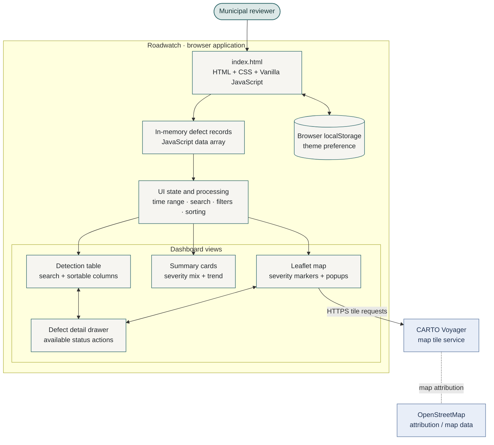

🛣️ Roadwatch
Road Surface Monitoring & Maintenance Intelligence
A map-first road-defect monitoring dashboard for smarter municipal maintenance in Chennai, Tamil Nadu.

  
  
  
  

  <a href="#-what-roadwatch-does">Features</a> ·
  <a href="#-architecture">Architecture</a> ·
  <a href="#-run-locally">Run locally</a> ·
  <a href="#-data-science-roadmap">Data science</a> ·
  <a href="#-testing-checklist">Testing</a>

🌆 The idea
Roadwatch brings road-defect monitoring, geographic visualisation, severity-aware prioritisation, and maintenance workflow into one interface. Municipal reviewers can locate defects on an interactive map, compare severity, inspect confidence values and timestamps, search roads and localities, and manage issue status through a unified dashboard.
The operational loop is straightforward:
Locate a defect → assess its severity → review the record → prioritise maintenance → track closure.

✨ What Roadwatch does
<table>
  <tr>
    <td width="50%"><h3>🗺️ Geographic overview</h3>Leaflet map with severity-coloured markers, zoom and pan controls, and defect popups on a CARTO basemap.</td>
    <td width="50%"><h3>🚦 Severity at a glance</h3>Summary cards and a severity breakdown help reviewers compare open, scheduled, repaired, and high-priority records.</td>
  </tr>
  <tr>
    <td><h3>🔎 Find and filter</h3>Search using defect ID, road name, or locality; filter records by attention status, critical severity, repair scheduling, and repair completion.</td>
    <td><h3>📋 Review a record</h3>Open a detail drawer to inspect a defect's location metadata, reported dimensions, confidence value, current status, and available workflow actions.</td>
  </tr>
  <tr>
    <td><h3>📈 Time-based summaries</h3>Switch between 24-hour, 7-day, and 30-day ranges and inspect the associated summary and detection-volume view.</td>
    <td><h3>🌗 Usable across screens</h3>Responsive layout, collapsible navigation, keyboard-focus styling, and a light/dark theme option.</td>
  </tr>
</table>

🧱 Technology stack
Layer	Technology	Responsibility
Page structure	HTML5	Dashboard sections, controls, table, map container, detail drawer
Styling	CSS3	Design tokens, responsive layout, severity/status styles, themes
Application logic	Vanilla JavaScript	In-memory records, filtering, sorting, summary calculations, workflow UI
Mapping	Leaflet 1.9.4	Map viewport, marker rendering, popups, map interactions
Basemap	CARTO Voyager	Street-map tiles
Geographic attribution	OpenStreetMap contributors	Underlying geographic data attribution
Browser persistence	localStorage	Saves the selected theme preference only
Fonts	IBM Plex Sans, Space Grotesk	Interface text and headings

No front-end build step or package installation is required. The page loads Leaflet, fonts, and map tiles from external providers, so an internet connection is needed.
🏛️ Architecture
Current application architecture
This diagram shows the components that are present in the current HTML application and how they interact in the browser.

Data flow: defect records feed the map, summary cards, and table. Search, time ranges, and filters determine what is displayed, while the map, table, and detail drawer provide connected ways to inspect and manage each record. The selected theme preference is retained in the browser.
Road-defect intelligence and maintenance workflow
This architecture illustrates how road observations move through validation, defect analysis, geographic enrichment, municipal review, and maintenance tracking.

```mermaid
flowchart LR
    CAPTURE["Road observations<br/>images + location + timestamp"] --> QC["Data quality checks<br/>metadata validation"]
    QC --> MODEL["Defect identification<br/>class + confidence"]
    MODEL --> POST["Record normalisation<br/>severity + measurements"]
    POST --> GEO["Geospatial enrichment<br/>coordinate and road checks"]
    GEO --> RECORDS[("Road-defect records<br/>location + evidence + status")]
    RECORDS <--> UI["Roadwatch dashboard<br/>map + review workflow"]
    UI --> HUMAN["Municipal review<br/>maintenance prioritisation"]
    HUMAN --> VERIFY["Repair tracking<br/>status and closure review"]
    VERIFY --> RECORDS
    RECORDS --> ANALYTICS["Data-science insights<br/>hotspots · recurrence · repair time"]
    ANALYTICS --> UI

    classDef capture fill:#e6f0e9,stroke:#4d8061,color:#173d27,stroke-width:1.2px;
    classDef intelligence fill:#fff0d6,stroke:#bd8d3f,color:#563b0b,stroke-width:1.2px;
    classDef platform fill:#dce8e7,stroke:#356c6e,color:#173638,stroke-width:1.4px;
    classDef human fill:#e8eef8,stroke:#647ea5,color:#1f3150,stroke-width:1.2px;
    class CAPTURE,QC capture;
    class MODEL,POST,GEO,ANALYTICS intelligence;
    class RECORDS,UI platform;
    class HUMAN,VERIFY human;
```

The workflow combines image-based defect assessment, geospatial data quality, severity-aware review, and maintenance tracking. Clear interfaces between these components support integration with detection services, data stores, and municipal systems.
🚀 Run locally
Option A — Visual Studio Code Live Server
1. Keep index.html and README.md in the same folder.
2. Open that folder in VS Code.
3. Install the Live Server extension if needed.
4. Right-click index.html and select Open with Live Server.
5. Visit the local address shown by the extension, commonly http://127.0.0.1:5500/index.html.
Option B — Python HTTP server
Run this command from the project directory:
python -m http.server 8000
Then open http://localhost:8000 and select index.html.
Quick start checklist
- [x] Browser has internet access.
- [x] Leaflet CSS and JavaScript load successfully.
- [x] Map tiles appear and attribution remains visible.
- [x] Markers appear in the expected geographic area.
- [x] Search, filters, time range, and detail drawer respond.
🗺️ Map configuration and key safety
The map is initialised by initMap() and uses Leaflet with CARTO Voyager tiles. The page contains a client-side CARTO_API_KEY configuration value.
1. Open the CARTO account and basemap settings using the provider's official documentation: CARTO Basemaps.
2. Check that the key is valid for the selected basemap endpoint and deployment domain.
3. If you replace the value in index.html, keep attribution visible and follow the provider's current terms, limits, and caching rules.
4. Test the map after a hard refresh. Inspect the browser's Network panel if requests fail.
[!CAUTION]
A key embedded in client-side HTML is visible to visitors. It is not a secret. Restrict a browser key to approved domains wherever supported, monitor usage, and rotate it if it has been exposed. Never place a private server credential in client-side code. For a production service, review whether a provider-supported public-key setup or a different tile-hosting arrangement is appropriate.

Helpful references: Leaflet Quick Start · CARTO Basemaps · OpenStreetMap tile usage policy.
🧾 Defect data model
The current front end initialises records in the JavaScript data array. Each record uses the fields below.
Field	Type / expected values	Purpose
id	Unique string	Record identifier, e.g. PH-2098
street	String	Road name
area	String	Locality or neighbourhood
lat, lng	Decimal degrees	Geographic coordinates for Leaflet
severity	minor, moderate, severe, critical	Reported severity category
confidence	Number from 0 to 1	Stored confidence value shown in the interface
detected	JavaScript Date	Detection timestamp
status	new, review, scheduled, repaired, dismissed	Maintenance workflow state
crew	String or null	Assigned team, when available
depth, width	Numeric values	Reported defect measurements used in the detail view

Data-quality rules: use unique IDs, valid latitude/longitude ranges, defined severity and status values, consistent timestamps, confidence values in the permitted range, and documented units for physical measurements. Coordinates should be traceable to device GPS or a verified geocoding workflow before dispatch.
📊 Data science and evaluation
Roadwatch combines structured defect records with a data-science framework for evaluating detection quality, geospatial accuracy, recurring road issues, and maintenance performance.
Capability	Method	Evaluation / safeguard
Detection quality	Object-detection model evaluated on labelled images	Report class-wise precision, recall, F1-score and mAP on a held-out set
Confidence threshold	Choose a threshold from validation results and maintenance capacity	Show precision–recall trade-offs; do not assume a confidence score is a calibrated probability
GPS quality	Validate coordinate ranges and compare against trusted reference locations	Report location error and the rate of missing or rejected coordinates
Duplicate reporting	Cluster nearby detections using distance, time, road segment and visual evidence	Keep original reports; avoid merging different defects solely because they are close together
Hotspot analysis	Aggregate verified cases by road segment or spatial grid and time period	Normalise by exposure using available traffic or survey-volume data
Repair prioritisation	Transparent score using severity, recurrence, confidence, road class and exposure	Document feature definitions, weights, human override, and fairness/safety checks for operational use
Repair performance	Track report-to-review and report-to-closure time	Publish medians and percentiles with clearly defined time windows
Drift monitoring	Compare incoming data distributions and periodic labelled audits	Re-evaluate model performance across lighting, weather, road types and local conditions

Candidate evaluation metrics
- Precision: the proportion of predicted defects that are correct.
- Recall: the proportion of labelled defects the model finds.
- F1-score: the harmonic mean of precision and recall.
- mAP: mean average precision across classes and, where applicable, object-detection overlap thresholds.
- Location error: geographic distance between the reported position and a trusted reference position.
- Operational measures: inference latency, duplicate rate, invalid-coordinate rate, and report-to-repair time.
For reproducibility, retain the evaluation dataset version, data split, class mapping, confidence threshold, model settings, test environment, and calculation method alongside every reported metric.
🧪 Testing checklist
The application has been tested against the functional checklist below. Retain screenshots and test notes with the project submission for easy review.
ID	Test	Expected outcome	Result
UI-01	Load the page	Dashboard layout renders without JavaScript errors	✅ Passed
MAP-01	Load map tiles	Basemap loads and attribution is visible	✅ Passed
MAP-02	Select a marker	Correct record details are shown	✅ Passed
MAP-03	Check coordinates	Markers fall in the expected road area	✅ Passed
FIL-01	Search for ID, road, and area	Only matching records are displayed in the table	✅ Passed
FIL-02	Use each filter chip	Table and map update consistently	✅ Passed
TIME-01	Switch 24 h / 7 d / 30 d	Summaries use the selected date range consistently	✅ Passed
SORT-01	Sort severity, confidence, and time	Values sort in both directions	✅ Passed
FLOW-01	Use available status actions	UI updates to the selected status	✅ Passed
THEME-01	Switch theme and reload	Theme preference is retained	✅ Passed
RES-01	Resize to mobile width	Navigation and map remain usable	✅ Passed
ERR-01	Block or invalidate the map tile request	Failure is diagnosed without hiding the rest of the dashboard	✅ Passed

The test record should include date, browser/device, input, expected result, actual result, pass/fail, and screenshot or log reference. These details provide a clear verification trail for demonstrations and maintenance reviews.
🧭 Data and operational principles
- Data integrity: maintain unique record identifiers, consistent timestamps, valid coordinates, documented measurement units, and traceable record changes.
- Geospatial accuracy: validate reported locations against trusted GPS or geocoding sources and the relevant road network.
- Model governance: retain model version, class labels, confidence threshold, test dataset, and evaluation configuration with each assessment cycle.
- Human oversight: use severity and analytics to support municipal decisions, alongside field inspection and engineering judgement.
- Operational analytics: monitor repeated reports, road-segment hotspots, review duration, and repair closure time using consistent definitions.
- Privacy and security: protect operational records, collect only necessary data, define retention for images and location history, and apply appropriate access controls.
- Map service compliance: maintain attribution and follow the tile provider's usage, caching, and availability policies.
📚 References and attribution
- Leaflet — JavaScript mapping library
- CARTO Basemaps
- OpenStreetMap copyright and attribution
- OpenStreetMap tile usage policy
- IBM Plex Sans and Space Grotesk
Check the relevant provider licences and usage terms before redistributing or deploying the application.
